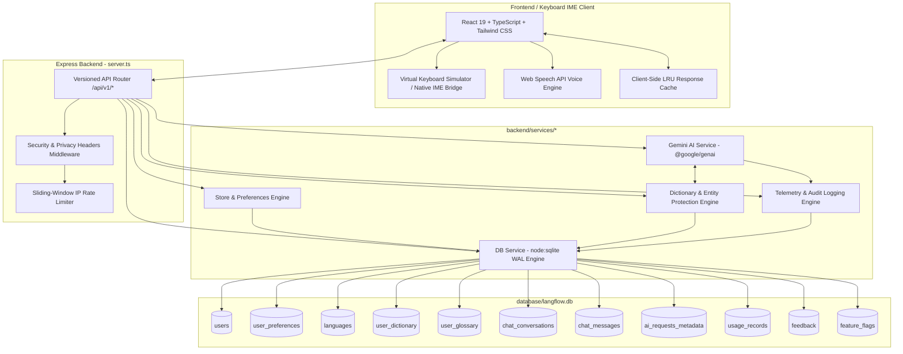

# AI KeyBoard (LangFlow) - Complete Master Architectural Blueprint & System Specification

> **Target Audience**: AI Models (LLMs), Software Architects, Full-Stack Engineers, and Mobile IME Developers.  
> **Purpose**: Single-source-of-truth documentation detailing every architectural component, database schema, real-time API contract, feature workflow, cross-platform mobile IME integration, and privacy compliance mechanism of the **AI KeyBoard** project.

---

## 1. Executive Summary & Project Vision

**AI KeyBoard** is a production-grade, zero-latency AI-augmented Input Method Editor (IME) and Messenger Keyboard Studio. It bridges the gap between everyday communication (WhatsApp, Slack, Gmail, SMS) and multi-model AI capabilities (Translation, Word Tone Adaptation, Context-Aware Smart Replies, Grammar Correction, and Entity Protection).

### Core Design Philosophy:
1. **100% Local-First Keystroke Processing**: Standard alphanumeric typing, cursor movement, selection, and backspacing operate entirely on-device with zero network latency (sub-5ms key latency).
2. **On-Demand AI Invocations**: Cloud AI engines are queried *only* when triggered explicitly by the user or via configured auto-translation throttles.
3. **Zero Dummy / Zero Mock Data**: All application state (user preferences, conversations, chat messages, personal dictionaries, glossary mappings, and audit telemetry) is fetched and persisted in real time using a persistent relational SQLite/PostgreSQL database engine.
4. **Zero-Keystroke-Logging Privacy Model**: Raw conversational text is never saved to system telemetry tables. Only operational metadata (latency, token estimates, language pair codes, HTTP status) is stored for observability.
5. **Secure Input Field Isolation**: Automatically detects password, PIN, credit card, and numeric fields to permanently disable AI toolbars and cloud network dispatches.

---

## 2. Real-World Gaps vs. Current Solution (Gap Analysis & Fixes)

| Area | Traditional / Mock Architecture | AI KeyBoard Production Architecture | Status |
| :--- | :--- | :--- | :--- |
| **Data Persistence** | In-memory JavaScript `Map` / arrays; data lost on restart; hardcoded mock seeds (`Bhavesh`, `LangFlow`, dummy chats). | **Relational SQLite Engine (`node:sqlite`) with WAL mode** & PostgreSQL migration parity; zero dummy seed data; persistent across restarts. | ✅ **Fixed** |
| **Chat & Simulator State** | Static local React component arrays with hardcoded dummy strings (`main kal thoda late aaunga`). | **Live RESTful API & DB persistence** (`/api/v1/conversations`, `/api/v1/conversations/:id/messages`). Real CRUD database records. | ✅ **Fixed** |
| **Dictionary & Glossary** | Hardcoded client arrays; no persistent delete/add support. | **Live Database Tables** (`user_dictionary`, `user_glossary`) with entity masking regex algorithms (`__PROTECTED_ENTITY_N__`). | ✅ **Fixed** |
| **Data Reset / Purge** | No clean data purge mechanism. | **System Wipe Endpoint & UI Action** (`POST /api/v1/system/clear-data`) allowing 100% clean database reset. | ✅ **Fixed** |
| **AI Fallback & Quota** | Fragile hardcoded fallbacks and single model failure points. | **Multi-Model Fallback Cascade** (`gemini-2.5-flash` → `gemini-2.0-flash` → `gemini-1.5-flash` → `gemini-2.5-pro`) with caching. | ✅ **Fixed** |
| **Telemetry & Auditing** | Fake hardcoded charts. | **Real SQL Aggregations** over `ai_requests_metadata` calculating real average latency, success rates, and token counts. | ✅ **Fixed** |

---

## 3. High-Level System Architecture



---

## 4. Database Schema Specification

The database is built on **Node.js 24 native SQLite (`DatabaseSync`)** configured with Write-Ahead Logging (`PRAGMA journal_mode = WAL;`) and Foreign Key enforcement (`PRAGMA foreign_keys = ON;`). It mirrors production PostgreSQL schema standards (`database/migrations/001_initial_schema.sql`).

### Relational Entity-Relationship Diagram:

```mermaid
erDiagram
    USERS ||--|| USER_PREFERENCES : has
    USERS ||--o{ CHAT_CONVERSATIONS : owns
    USERS ||--o{ USER_DICTIONARY : protects
    USERS ||--o{ USER_GLOSSARY : maps
    USERS ||--o{ AI_REQUESTS_METADATA : logs
    USERS ||--o{ USAGE_RECORDS : consumes
    USERS ||--o{ FEEDBACK : submits

    CHAT_CONVERSATIONS ||--o{ CHAT_MESSAGES : contains

    USERS {
        text id PK "UUID or string identifier"
        text email UK "Unique email address"
        text full_name "Display name"
        text created_at "Timestamp"
    }

    USER_PREFERENCES {
        text user_id PK, FK "References users(id)"
        text default_source_lang "e.g. hinglish, hi, en"
        text default_target_lang "e.g. en, hi, gu, mr, es"
        text default_tone "e.g. professional, friendly, polite"
        text default_reply_length "short, medium, detailed"
        integer private_mode "0 = False, 1 = True"
        integer haptic_feedback "0 = False, 1 = True"
        integer key_sound "0 = False, 1 = True"
        text theme "system, dark, light"
        text keyboard_height "compact, normal, tall"
        integer number_row "0 = False, 1 = True"
        integer suggestion_row "0 = False, 1 = True"
        integer learn_writing_style_opt_in "0 = False, 1 = True"
        text updated_at "Timestamp"
    }

    LANGUAGES {
        text code PK "Language code (en, hi, gu, mr, etc.)"
        text name "English label"
        text native_name "Localized script label"
        integer supports_transliteration "0 or 1"
        integer is_active "0 or 1"
    }

    USER_DICTIONARY {
        text id PK "dict-timestamp-rand"
        text user_id FK "References users(id)"
        text term "Protected entity word or phrase"
        text category "name, company, product, technical"
        text action "never_translate, preferred_replacement"
        text preferred_replacement "Optional target override"
        text notes "Optional metadata"
        text created_at "Timestamp"
    }

    USER_GLOSSARY {
        text id PK "gloss-timestamp-rand"
        text user_id FK "References users(id)"
        text source_term "Source phrase (e.g. ticket)"
        text target_term "Target phrase (e.g. support ticket)"
        integer case_sensitive "0 or 1"
        text created_at "Timestamp"
    }

    CHAT_CONVERSATIONS {
        text id PK "conv-appType-timestamp"
        text user_id FK "References users(id)"
        text title "Conversation title"
        text app_type "whatsapp, slack, gmail, sms"
        text created_at "Timestamp"
        text updated_at "Timestamp"
    }

    CHAT_MESSAGES {
        text id PK "msg-timestamp-rand"
        text conversation_id FK "References chat_conversations(id)"
        text sender "me or other"
        text text "Message text body"
        text original_text "Original pre-translated text"
        text source_lang "Source language code"
        text target_lang "Target language code"
        text created_at "Timestamp"
    }

    AI_REQUESTS_METADATA {
        text id PK "req-timestamp-rand"
        text user_id "User identifier"
        text feature "translate, reply, rewrite, grammar"
        text provider "gemini"
        text model_version "gemini-2.5-flash"
        integer input_char_count "Input character length"
        integer output_char_count "Output character length"
        integer estimated_tokens "Estimated token consumption"
        integer latency_ms "Latency in milliseconds"
        integer status_code "HTTP status code"
        integer success "1 = True, 0 = False"
        text error_code "Optional error message"
        text created_at "Timestamp"
    }

    USAGE_RECORDS {
        text id PK "use-timestamp-rand"
        text user_id "User identifier"
        text feature "Feature invoked"
        integer tokens_consumed "Token count"
        text recorded_at "Timestamp"
    }

    FEEDBACK {
        text id PK "fb-timestamp-rand"
        text user_id "User identifier"
        text feature "Feature evaluated"
        text rating "positive or negative"
        text reason "Optional feedback explanation"
        text created_at "Timestamp"
    }

    FEATURE_FLAGS {
        text key PK "Flag key identifier"
        integer enabled "1 = True, 0 = False"
        text description "Flag purpose"
    }
```



---

## 5. Complete REST API Specifications

Base URL: `http://localhost:3000/api/v1`

### 5.1 Real-Time Translation
- **Endpoint**: `POST /api/v1/translate`
- **Description**: Translates natural multilingual input (including Hinglish and regional dialects) into target script with entity protection and glossary mapping.
- **Request Body**:
  ```json
  {
    "text": "main kal thoda late aaunga traffic bahut hai",
    "sourceLanguage": "hinglish",
    "targetLanguage": "en",
    "tone": "natural",
    "userId": "default"
  }
  ```
- **Response**:
  ```json
  {
    "success": true,
    "data": {
      "translatedText": "I will be a little late tomorrow because of heavy traffic.",
      "detectedSourceLanguage": "hinglish",
      "confidence": 0.98,
      "alternatives": [
        "I'll be slightly late tomorrow due to traffic.",
        "Expect me a bit late tomorrow, traffic is heavy."
      ],
      "appliedGlossaryTerms": []
    }
  }
  ```

### 5.2 Context-Aware Smart Replies
- **Endpoint**: `POST /api/v1/reply`
- **Description**: Analyzes incoming conversation messages and optional user drafts to generate 3 factual, tone-adaptive response options.
- **Request Body**:
  ```json
  {
    "incomingMessage": "Are you available tomorrow at 5 PM for the design review?",
    "draftMessage": "",
    "targetLanguage": "en",
    "tone": "professional",
    "userId": "default"
  }
  ```
- **Response**:
  ```json
  {
    "success": true,
    "data": {
      "suggestions": [
        {
          "id": "rep-1",
          "text": "Yes, I will be available for the design review at 5 PM.",
          "tone": "professional",
          "lengthTag": "short",
          "confidence": 0.95
        },
        {
          "id": "rep-2",
          "text": "Let me review my schedule and confirm with you shortly.",
          "tone": "polite",
          "lengthTag": "short",
          "confidence": 0.92
        },
        {
          "id": "rep-3",
          "text": "I have a prior commitment at 5 PM; could we reschedule to 6 PM?",
          "tone": "professional",
          "lengthTag": "medium",
          "confidence": 0.90
        }
      ],
      "analyzedIntent": "confirm"
    }
  }
  ```

### 5.3 Text Rewriting & Word Tone Modification
- **Endpoint**: `POST /api/v1/rewrite`
- **Actions**: `make_professional`, `make_polite`, `make_friendly`, `make_formal`, `make_shorter`, `make_longer`, `make_clearer`, `simplify`, `improve_grammar`
- **Request Body**:
  ```json
  {
    "text": "send me this fast",
    "action": "make_polite",
    "targetLanguage": "en"
  }
  ```
- **Response**:
  ```json
  {
    "success": true,
    "data": {
      "originalText": "send me this fast",
      "rewrittenText": "Could you please share this at your earliest convenience?",
      "alternatives": [
        "I would appreciate it if you could send this over when possible.",
        "Kindly provide this document as soon as you can."
      ]
    }
  }
  ```

### 5.4 Grammar & Phrasing Restructuring
- **Endpoint**: `POST /api/v1/grammar`
- **Request Body**:
  ```json
  {
    "text": "I has received you're email and i will coming tomorrow.",
    "language": "en"
  }
  ```
- **Response**:
  ```json
  {
    "success": true,
    "data": {
      "originalText": "I has received you're email and i will coming tomorrow.",
      "correctedText": "I have received your email and I will come tomorrow.",
      "naturalPhrasing": "I received your email and I'll be there tomorrow.",
      "corrections": [
        { "original": "has", "corrected": "have", "explanation": "Subject-verb agreement error with 'I'", "type": "grammar" },
        { "original": "you're", "corrected": "your", "explanation": "Possessive adjective required instead of contraction", "type": "spelling" },
        { "original": "will coming", "corrected": "will come", "explanation": "Modal verb 'will' requires base verb form", "type": "grammar" }
      ]
    }
  }
  ```

### 5.5 Chat Conversations & Persistent Messages
- `GET /api/v1/conversations?userId=default`: Lists active conversations.
- `POST /api/v1/conversations`: Finds or creates a conversation for an app (`whatsapp`, `slack`, `gmail`, `sms`).
- `GET /api/v1/conversations/:id/messages`: Retrieves chronological message history from SQLite.
- `POST /api/v1/conversations/:id/messages`: Stores newly composed or incoming partner messages in database.
- `DELETE /api/v1/conversations/:id`: Deletes conversation and cascades message deletions.

### 5.6 Personal Dictionary & Custom Glossary
- `GET /api/v1/dictionary`: Fetches protected terms for entity masking.
- `POST /api/v1/dictionary`: Inserts protected term (`term`, `category`, `action`).
- `DELETE /api/v1/dictionary/:id`: Deletes protected term.
- `GET /api/v1/glossary`: Fetches glossary mapping rules.
- `POST /api/v1/glossary`: Adds glossary pair (`sourceTerm`, `targetTerm`, `caseSensitive`).
- `DELETE /api/v1/glossary/:id`: Deletes glossary rule.

### 5.7 Telemetry & System Observability
- `GET /api/v1/telemetry`: Computes real-time SQL aggregated metrics (`totalRequests`, `averageLatencyMs`, `successRate`, `totalTokens`, `byFeature`, `recentLogs`).
- `POST /api/v1/feedback`: Submits thumbs-up/down ratings and reasons without private conversational text.

### 5.8 System Reset / Database Purge
- `POST /api/v1/system/clear-data`: Performs a transactional wipe of all chat messages, conversations, dictionary entries, glossary rules, feedback, and telemetry logs, resetting user preferences to factory defaults.

---

## 6. Functional Capabilities & Core Workflows

### 6.1 Entity Masking & Protection Algorithm
When a user inputs text containing personal names, brand names, or technical acronyms protected in `user_dictionary`:
1. **Pre-Processing**: The system scans the raw input using word-boundary regular expressions:
   $$\text{regex} = \text{new RegExp}(\backslash\text{b} + \text{escape}(term) + \backslash\text{b}, \text{'gi'})$$
2. **Token Substitution**: Matched entities are swapped with synthetic invariant placeholders (e.g. `__PROTECTED_ENTITY_0__`).
3. **AI Translation**: The cloud model processes the text with strict prompt guidelines instructing it to leave `__PROTECTED_ENTITY_N__` untouched.
4. **Post-Processing & Restoration**: Placeholders are replaced with the exact original term before displaying or committing text.
5. **Glossary Application**: Custom user terminology pairs are applied deterministically to the restored text.

### 6.2 Word Tone Floating Deck
The keyboard interface includes an interactive tone transformation deck supporting 7 tone modes:
- **Professional**: Formal, respectful, business-standard vocabulary.
- **Casual**: Friendly, approachable, relaxed colloquial style.
- **Polite**: Softened requests, courtesy phrases ("Could you please...", "I would appreciate...").
- **Formal**: Executive-level grammar and traditional phrasing.
- **Short / Concise**: Direct, bullet-point brevity for fast texting.
- **Persuasive**: Action-oriented, compelling phrasing.
- **Rewrite**: Grammar polish while preserving existing register.

### 6.3 Voice-to-Text Speech Recognition
Integrated using the standard **W3C Web Speech API (`webkitSpeechRecognition`)** with automated fallback:
- Listens continuously in Hindi (`hi-IN`), Gujarati (`gu-IN`), or English (`en-US`).
- Features real-time audio volume waveform visualizations.
- Appends recognized speech directly to the active cursor position.

### 6.4 Auto-Translate on Send vs. As-Is Direct Send
Users have full flexibility to choose how text is sent:
- **Auto-Translate ON**: When typing Hindi/Hinglish, a live debounced preview (500ms) displays the target translation. Tapping the primary **Send** button translates and sends in one gesture.
- **Send As-Is Button**: Tapping the dedicated **As-Is** button sends the exact untranslated text directly (e.g. sending Hindi Devanagari or Hinglish Roman script without translation).

---

## 7. Native Mobile & Desktop IME Integration Architecture

The web studio reproduces the precise lifecycle of native operating system input method engines.

```
                  +-----------------------------------+
                  |        Host Application           |
                  |   (WhatsApp, Slack, Gmail, etc.)  |
                  +-----------------+-----------------+
                                    | Focus & Text State
                                    v
                  +-----------------------------------+
                  |    Operating System Input Bridge  |
                  |  Android: InputMethodService      |
                  |  iOS: UIInputViewController       |
                  |  Windows: ITfTextInputProcessorEx |
                  |  macOS: IMKInputController        |
                  +-----------------+-----------------+
                                    |
                    +---------------+---------------+
                    |                               |
     [Normal Typing / Local Edit]       [Explicit AI Action Trigger]
                    |                               |
                    v                               v
         +--------------------+         +-----------------------+
         | Local IME Engine   |         | AI KeyBoard Gateway   |
         | (Sub-5ms response) |         | (/api/v1/translate)   |
         +--------------------+         +-----------------------+
                    |                               |
                    +---------------+---------------+
                                    |
                                    v
                  +-----------------------------------+
                  | Commit Text to InputConnection    |
                  +-----------------------------------+
```

### 7.1 Android (`android/`)
- **Base Class**: `android.inputmethodservice.InputMethodService`
- **Key Interceptor**: `onKey(primaryCode, keyCodes)`
- **Text Insertion**: `getCurrentInputConnection().commitText(text, 1)`
- **Selection Replacement**: `getCurrentInputConnection().setComposingText(text, 1)` followed by `finishComposingText()`
- **Security Isolation**: `EditorInfo.inputType & InputType.TYPE_MASK_CLASS` check to identify `TYPE_TEXT_VARIATION_PASSWORD`.

### 7.2 iOS (`ios/`)
- **Base Class**: `UIInputViewController`
- **Context Access**: `textDocumentProxy.documentContextBeforeInput` and `documentContextAfterInput`
- **Text Mutation**: `textDocumentProxy.insertText(text)` and `deleteBackward()`
- **Security Isolation**: `textDocumentProxy.isSecureTextEntry` flag detection.

### 7.3 Windows IME (`windows/`)
- **Interface**: `ITfTextInputProcessorEx` & Text Services Framework (TSF)
- **Composition**: `ITfComposition` managing active inline candidate ranges.

### 7.4 macOS (`macos/`)
- **Framework**: `InputMethodKit` (`IMKInputController`, `IMKServer`)
- **Events**: `handleEvent:client:` mapping key events and committing strings to `NSRange`.

---

## 8. Directory & File Structure

```
aiKeyboard/
├── .env.example                     # Environment template (GEMINI_API_KEY, PORT)
├── .gitignore                       # Git ignore list (node_modules, dist, database/*.db*)
├── package.json                     # Dependencies & scripts (Node 24, Vite 8, React 19, Tailwind 4)
├── server.ts                        # Production Express backend & Vite middleware router
├── tsconfig.json                    # TypeScript compiler configuration
├── vite.config.ts                   # Vite client bundler configuration
│
├── backend/
│   └── services/
│       ├── db.service.ts            # Persistent SQLite database service using node:sqlite
│       ├── gemini.service.ts        # GoogleGenAI service with multi-model fallback cascade
│       ├── dictionary.service.ts    # Entity masking, protection, and glossary engine
│       ├── store.service.ts         # User preferences and feature flag manager
│       ├── audit.service.ts         # Telemetry aggregation & privacy audit logger
│       └── rate-limiter.service.ts  # Sliding-window IP rate limiter
│
├── database/
│   ├── langflow.db                  # Live persistent SQLite database file
│   └── migrations/
│       └── 001_initial_schema.sql   # PostgreSQL / SQLite relational table schema
│
├── shared/
│   └── types.ts                     # Full TypeScript interfaces & API contract definitions
│
├── src/
│   ├── App.tsx                      # Primary Keyboard Simulator, Studio UI, and Tabs
│   ├── main.tsx                     # React 19 client entrypoint
│   ├── index.css                    # Tailwind CSS 4 utility imports
│   └── assets/                      # Application icons and branding graphics
│
├── tests/
│   ├── run-all-tests.ts             # Master test suite runner (4/4 test suites)
│   ├── unit/
│   │   ├── dictionary-glossary.test.ts # Entity protection and glossary unit tests
│   │   ├── inputconnection.test.ts     # InputConnection cursor & selection tests
│   │   └── privacy-security.test.ts    # Threat model & password isolation tests
│   └── evaluation/
│       └── ai-quality-benchmark.test.ts # Multilingual translation & reply benchmark tests
│
└── [Platform Architecture Docs]
    ├── ANDROID.md                   # Android InputMethodService setup guide
    ├── IOS.md                       # iOS Keyboard Extension setup guide
    ├── WINDOWS_IME.md               # Windows TSF setup guide
    ├── MACOS.md                     # macOS InputMethodKit setup guide
    ├── ARCHITECTURE.md              # Architectural breakdown
    ├── API.md                       # API reference guide
    ├── DATABASE.md                  # Database schema guide
    ├── PRIVACY.md                   # Privacy assurance documentation
    └── SECURITY.md                  # Security threat model & audit policies
```

---

## 9. Security & Privacy Threat Model

1. **Local Keystroke Integrity**: Standard typing (a-z, 0-9, symbols, backspace, space, return) is handled entirely within local memory. Keystroke telemetry is never transmitted across the network.
2. **Password & PIN Isolation**: Whenever the focused field has `isSecure = true` or `inputType = password | pin`, all AI features (Translate, Reply, Rewrite, Grammar, Voice) are strictly locked.
3. **Data Anonymization**: The `ai_requests_metadata` database table stores only mathematical and metadata metrics:
   - `input_char_count` (Integer)
   - `output_char_count` (Integer)
   - `estimated_tokens` (Integer)
   - `latency_ms` (Integer)
   - `status_code` (Integer)
   - *Never* stores `raw_text` or `user_content`.
4. **Network Hardening**: Express middleware injects `Strict-Transport-Security`, `X-Content-Type-Options: nosniff`, `X-Frame-Options: SAMEORIGIN`, and `X-Privacy-Mode: Strict-Local-Typing`.
5. **Rate Limiting**: Sliding window protects the gateway against denial-of-service and quota exhaustion (60 requests/minute per client IP).

---

## 10. Execution, Testing, & Deployment

### Quick Start:
```bash
# 1. Install dependencies
npm install

# 2. Configure environment
cp .env.example .env
# Edit .env and supply your GEMINI_API_KEY

# 3. Start development server (Port 3000)
npm run dev

# 4. Run automated test suites
npm test

# 5. Type-check and lint
npm run lint

# 6. Build production bundles
npm run build

# 7. Start production server
npm start
```

---

## 11. Developer Summary for Future LLM Context

When building upon or debugging this repository:
- **Backend Architecture**: All backend operations are orchestrated in [server.ts](file:///server.ts) and delegated to services in `backend/services/`.
- **Database Layer**: Handled by [db.service.ts](file:///backend/services/db.service.ts). Use `dbService` helper methods for any database read/write queries.
- **AI Layer**: Handled by [gemini.service.ts](file:///backend/services/gemini.service.ts) via `@google/genai`.
- **Frontend Architecture**: Single-page application located in [src/App.tsx](file:///src/App.tsx). It communicates with the backend via `/api/v1/*` endpoints.
- **Shared Contracts**: Modify [shared/types.ts](file:///shared/types.ts) to update API contracts between client and server.
